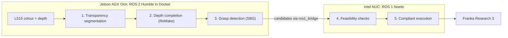

# Grasping Transparent Objects with Learned Depth Completion

Depth cameras struggle to measure transparent objects: infrared light passes through glass and
clear plastic, so the camera reports the table behind a glass instead of the glass itself. This
project builds a robot that picks up transparent and opaque objects using a single Intel RealSense
L515 camera on the gripper of a Franka Research 3 arm. A segmenter finds the transparent objects in
the colour image, a depth-completion network (ReMake) repairs their depth, and the arm grasps using
the repaired depth. All perception runs on an NVIDIA Jetson AGX Orin.

Final-year project for the Bachelor of Engineering (Computer Engineering), Department of Electrical
and Computer Engineering, National University of Singapore, academic year 2026/2027.
**Author:** Chan Sheng Bin. **Supervisors:** Prof Marcelo Ang and Prof Prahlad Vadakkepat.
**Project page:** https://shengbin-101.github.io/transparent-grasp-stack/

## How it works



| Stage | What it does |
|---|---|
| **1. Segmentation** | A prompt-free transparency segmenter: a small head (1.28 M parameters) on the frozen Depth Anything V2 encoder that ReMake already runs, trained on TransCG's masks. It needs only the colour image and takes about 0.3 s per frame on the Orin, against about 1.2 s for SAM 3. Each transparent region of at least 9 cm² becomes a grasp target. Opaque targets come from the raw depth: anything standing at least 2 cm above the fitted table. |
| **2. Depth completion** | ReMake is given the transparency mask grown by 5 px, and its depth replaces the camera's only inside the mask, so an opaque object keeps the sensor's own measurement unless the segmenter marks part of it. The weights are a fine-tune trained to cope with a missing mask or missing sensor depth. About 1.2 s. |
| **3. Grasp detection** | Scale-Balanced Grasp (SBG) proposes 6-DoF grasps from 20,000 points of the repaired point cloud. Each grasp's approach is chosen from the directions within 30° of vertical. Grasps with a negative score, grasps that pass through the point cloud and grasps that would close on nothing are dropped. Only grasps that land on a target and fit the hand's 70 mm limit are sent on. About 1.2 s. |
| **4. Feasibility checks** | A planner on the arm's computer samples every straight-line leg of the pick every 1 cm and 2°, solves the inverse kinematics at each sample, and refuses a grasp that brings a joint within 0.05 rad of its limit, the arm or the camera within 30 mm of the table, the arm, hand, camera or open fingers within 10 mm of another object, or the arm, hand or camera into the object being grasped (only the space inside the open gripper is cleared). It works through candidates for up to 5 s (a median 1.4 s) and ranks the feasible ones by SBG's confidence times a comfort score for the arm. |
| **5. Execution** | A Cartesian impedance controller (1000 N/m) moves the arm to a standoff 10 cm back along the approach and then in to the grasp. The approach stops on contact (2 N above a rolling reference), the gripper closes with 20 N, and the arm lifts and returns home. |

From the run request to the grasp pose, before any planning or arm motion, takes a median 4.6 s on the
Orin with ADAPTED and 5.8 s with BASELINE, which also runs SAM 3. That is wall clock. The stage times
above are each node's own, the capture (0.7 s) and the grasp-pose node (0.3 s) are not in the table, and
the service calls between the stages add about 0.7 s. An executed pick,
planning included, then takes about 100 s, most of it the arm's slow, compliant motion. These are the
medians of the trials' top-down runs (`trials/timings.py`).

## Results

### Robot trials

A pre-registered experiment at a top-down view with six objects, each placed alone: four transparent
(a translucent mug, a plastic bottle lying flat, a plastic bowl and a glass cup) and two opaque (a tape
roll and a cardboard box). There were three attempts per object and condition, 54 in all. Success
means the object was lifted and held for 3 s.

| Condition | Depth the grasps are planned on | Transparent held | Opaque held |
|---|---|---|---|
| RAW | the camera's raw depth | 1 of 12 (8 %) | 4 of 6 (67 %) |
| BASELINE | released ReMake, on SAM 3's mask | 8 of 12 (67 %) | 3 of 6 (50 %) |
| ADAPTED | fine-tuned ReMake, on this project's segmenter's mask | 7 of 12 (58 %) | 3 of 6 (50 %) |

Repaired depth made transparent objects graspable. The two ReMake conditions are one attempt in
twelve apart. A side view was also planned, but a
check before those trials found that the arm could reach a grasp on only one of the six objects, so
the side-view trials were not run. The limit there was the arm, the grasp detector and the camera's
mounting, not the depth. Every attempt: [`trials/`](trials/README.md).

### Depth completion

ReMake's error inside transparent objects on 1,177 test frames of the TransCG benchmark (masked
RMSE, lower is better):

| ReMake, with this mask | Error |
|---|---|
| the dataset's own mask (how the benchmark scores it) | 11.2 mm |
| SAM 3's mask from a text prompt, "transparent object or bottle" (what a robot would have) | 28.9 mm |
| this project's segmenter (grown 5 px, as on the robot) | 14.4 mm |

- **The benchmark relies on a perfect mask.** With a real segmenter's mask, ReMake's error more than
  doubles. The prompt-free segmenter halves that error. Its mask has IoU 0.887 on TransCG against 0.377 for
  SAM 3, and 0.814 and 0.742 on ClearGrasp's real test and validation images, which it never saw in training.
- **Training for imperfect inputs.** Two training augmentations, mask dropout and blanking the
  sensor's depth under the mask, cut ReMake's error with no mask from 46.4 to 18.8 mm, and with no
  sensor depth from 25.9 to 16.2 mm. With the segmenter's mask the fine-tuned and released weights
  score the same (14.2 and 14.4 mm), so the segmenter brings the accuracy and the fine-tune adds
  robustness.
- **A bug in ReMake's released training code.** The depth prior is copied before the random flips,
  so on 75 % of training samples it shows a mirrored scene and the network learns to ignore it.
- **Open problem.** On tape-measured frames from the robot, every model still places a transparent
  mug's rim 47–57 mm too low.

The numbers above follow the dissertation as revised on 26 Nov 2026.

The project began as fusion of a 60 GHz mmWave radar (TI IWR6843AOP) with an RGB-D camera.
Measurements showed that the radar's antenna array is too small to separate neighbouring objects,
so the project moved to learned depth completion. The radar code is in a separate repository,
[xwr_raw_ros](https://github.com/ShengBin-101/xwr_raw_ros): a ROS 2 driver for the radar, its
processing, and the scripts and data for the dissertation's radar figures.

## Hardware and software

| Component | Model |
|---|---|
| Arm | Franka Research 3 with the Franka Hand (parallel jaw, opens to 80 mm) |
| Camera | Intel RealSense L515 (time-of-flight) on the gripper: depth 640×480 at 30 Hz, colour 1280×720 at 15 Hz |
| Perception computer | NVIDIA Jetson AGX Orin Developer Kit (12-core Arm CPU, 32 GB) |
| Arm computer | Intel NUC |
| Training | NVIDIA RTX 3090 (24 GB) |

| Computer | Software |
|---|---|
| Jetson AGX Orin | Ubuntu 22.04, Jetson Linux R36.5.2 (JetPack 6), CUDA 12.6, cuDNN 9.3. One Docker image with ROS 2 Humble, PyTorch 2.10, OpenCV, librealsense 2.53.1, realsense-ros 4.51.1 and `ros1_bridge` |
| Intel NUC | Ubuntu 20.04, ROS 1 Noetic with a real-time kernel, `franka_ros` 0.10.1 (patched), libfranka 0.10.0. The planner and commander are written in Python for this project |
| Training | PyTorch with ReMake's training code and this project's changes ([`training/`](training/README.md)) |

## Quick start: no camera, no robot

Needs a Jetson AGX Orin with Jetson Linux R36.4 or later (JetPack 6; tested on R36.5.2 with CUDA 12.6 and
cuDNN 9.3, which the container takes from the host), Docker with the NVIDIA runtime, about 25 GB of
free disk, network access for the build and the weights, and gdown on the host (`pip install gdown`)
for the two weights that come from Google Drive.

```bash
git clone --recursive https://github.com/ShengBin-101/transparent-grasp-stack.git
cd transparent-grasp-stack
sudo cp docker/udev/*.rules /etc/udev/rules.d/ && sudo udevadm control --reload && sudo udevadm trigger  # once, for the L515
./build.sh                        # about 1 h the first time
scripts/get_checkpoints.sh        # every weight, SHA-256 checked
./start.sh                        # opens a shell in the container
scripts/check_setup.sh            # in the container: what this setup can run
scripts/demo_offline.sh all       # the pipeline on 4 recorded captures, checked against expected results
```

The container runs privileged, on the host network, with `/dev` mounted (the camera and ROS need
them), and its shells use `umask 000`, so files it writes are world-writable.

## Run it live

```bash
rg-adapted       # start every node: the trials' ADAPTED (or rg-baseline, rg-raw); needs the L515
rg-run           # one capture to grasp pose, about 4.6 s once warm (ADAPTED)
rg-down          # stop
```

Each run is archived in `runs/<date>_<time>_auto/` (`runs/<date>_<time>_failed_<stage>/` when a stage fails). Foxglove shows the masks, the repaired depth and
the grasps at `ws://<orin-ip>:8765`. SAM 3, which the BASELINE preset uses, needs approved access to
`facebook/sam3` on Hugging Face and one `hf auth login`.

## Pick with the arm

Keep a hand on the stop button. Set up the NUC once ([`nuc/README.md`](nuc/README.md)), then on
the NUC:

```bash
./run_controller.sh     # terminal 1
./run_commander.sh      # terminal 2
```

In the container, `rg-run`, then `rg-pick`. To plan every leg without moving the arm, start the
bridge with `ros2 launch remake_grasp bridge.launch.py dry_run:=true`.

## Presets

One per trial condition:

| `PIPELINE` | Mask | ReMake weights | Grasp targets | Start it with |
|---|---|---|---|---|
| `adapted` (default) | the segmenter | `L_combo_both` | transparent from the mask, opaque from the raw depth | `rg-adapted` |
| `baseline` | SAM 3, "transparent object" | the authors' release | the same | `rg-baseline` |
| `raw` | none | none | none: every grasp counts | `rg-raw` |

Single settings (`MASK`, `REMAKE`, `TARGETS`, `DETECTOR`, `PROFILE`), every command, the output files
and troubleshooting are in [`docs/REFERENCE.md`](docs/REFERENCE.md). PEGG-Net (`DETECTOR=peggnet`,
one top-down grasp per object) is an alternative detector the trials did not use.

## Reproduce the results

[`docs/REPRODUCE.md`](docs/REPRODUCE.md): the offline demo, the TransCG benchmark rows, the trial
replays, the training, and which result comes from where.

## Repository layout

| Path | Contents |
|---|---|
| `ros/remake_grasp/` | the ROS 2 package: nodes, launch files, config |
| `segmenter/` | the prompt-free transparency segmenter: model, training, evaluation |
| `nuc/` | the NUC's ROS 1 workspace: commander, planner, controllers, offline replay |
| `third_party/` | ReMake, SBG and SAM 3 as git submodules, PEGG-Net's model file |
| `docker/`, `build.sh`, `start.sh` | the image and the container |
| `scripts/` | weights, setup check, offline demo, benchmark, pre-flight |
| `tmuxp/` | the tmux session layouts behind `rg-up`, `rg-adapted`, `rg-baseline` and `rg-raw` |
| `samples/`, `eval/`, `tests/` | recorded captures, the TransCG benchmark, tests |
| `training/` | how the deployed ReMake fine-tune was trained, with its records and those of the runs it is compared with |
| `trials/` | the robot trials: attempt records, analysis and the paired replay |
| `tools/` | the hand-eye calibration; SAM 3's text-prompt masks for the benchmark |
| `docs/` | the reference and reproduction guides |
| `page/` | the project page's source, published by `.github/workflows/pages.yml` |
| `checkpoints/` | `SHA256SUMS` and a README; the weights come from the release |

## Known limits

- The calibration values (the hand-eye, the table height, the home pose) belong to one rig; another
  rig must re-measure them ([`nuc/README.md`](nuc/README.md#69-rig-specific-values)).
- The x86_64 build path is written but has never been run.
- The four-model comparison on the benchmark ran in a separate analysis environment and is not
  included. Its results are in the dissertation. [`docs/REPRODUCE.md`](docs/REPRODUCE.md#not-reproducible-from-this-release)
  lists every finding the release cannot reproduce.
- The L515 is discontinued; the camera launch file supports only it.

## Licence

- The code is under the MIT licence ([`LICENSE`](LICENSE)), copyright National University of
  Singapore.
- The model weights in the v1.0 release are under CC BY-NC 4.0, because they are trained on TransCG,
  which is CC BY-NC 4.0.
- The documentation, figures and trial records are under CC BY 4.0.
- The project page (`page/`) adapts the Academic Project Page Template and is under CC BY-SA 4.0,
  like the template.
- Third-party code, weights and datasets keep their own licences:
  [`THIRD_PARTY_NOTICES.md`](THIRD_PARTY_NOTICES.md).

## Citation

```bibtex
@thesis{chan_transparent_grasping,
  title  = {Robotic Grasping of Transparent Objects: From Radar--Camera Fusion to Learned Depth Completion},
  author = {Chan, Sheng Bin},
  school = {National University of Singapore},
  type   = {Bachelor's dissertation},
  year   = {2026}
}
```

## Acknowledgements

Thanks to Prof Marcelo Ang and Prof Prahlad Vadakkepat for their supervision, and to the Advanced
Robotics Centre (ARC) at NUS for the RTX 3090 on which every model in this project was trained.
This project builds on [ReMake](https://github.com/ChengYaofeng/ReMake),
[Scale-Balanced Grasp](https://github.com/mahaoxiang822/Scale-Balanced-Grasp),
[SAM 3](https://github.com/facebookresearch/sam3),
[Depth Anything V2](https://github.com/DepthAnything/Depth-Anything-V2),
[PEGG-Net](https://github.com/HZWang96/PEGG-Net), and the
[TransCG](https://graspnet.net/transcg) and [ClearGrasp](https://sites.google.com/view/cleargrasp)
datasets.
